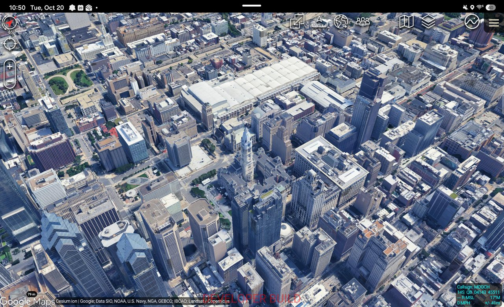

# Cesium ion for TAK

Plugins that bring [Cesium ion](https://cesium.com/platform/cesium-ion/) 3D
content into TAK apps: sign in with a Cesium ion account and add
photorealistic 3D cities, 3D buildings, imagery and terrain to the TAK map,
from Cesium ion in the cloud or from your own on-premises Cesium ion
Self-Hosted server.



## Choose your TAK app

| TAK app | Platform | Status | Get it | Guide |
|---|---|---|---|---|
| **ATAK** | Android | v1.0.2 released (ATAK-CIV 5.7, signed by TAK.gov) | [Releases](../../releases) (`atak-v…`) | [`atak/`](atak/README.md) |
| **VR-TAK** | Windows, desktop and VR headset | Early version; not released yet | Coming | [`vrtak/`](vrtak/README.md) |
| **TAKX** | Windows (successor to WinTAK) | Planned | Coming | [`takx/`](takx/README.md) |

Each guide has step-by-step install instructions with screenshots, and a
section for developers.

## What you can add

| Content from Cesium ion | ATAK | VR-TAK |
|---|---|---|
| Google Photorealistic 3D Tiles | Yes | Yes |
| 3D Tiles (Cesium OSM Buildings, photogrammetry, your own tilesets) | Yes | Yes |
| Imagery (Bing Maps, your own imagery) | Yes | Yes |
| Terrain (Cesium World Terrain, your own) | Yes | Yes |
| GeoJSON, KML | Yes | Not yet |

Both plugins work with **Cesium ion Cloud** (sign in with your Cesium ion
account, including "Log in as a team") and **Cesium ion Self-Hosted**
(enter your server's address). You never copy or paste an access token.

## Repository layout

| Path | Contents |
|---|---|
| [`atak/`](atak/README.md) | ATAK plugin (ATAK-CIV 5.7, Android) |
| [`vrtak/`](vrtak/README.md) | VR-TAK plugin (Unreal Engine 5.3, Cesium for Unreal) |
| [`takx/`](takx/README.md) | TAKX plugin (planned) and WinTAK background |
| [`core/`](core/README.md) | Shared Cesium ion client in Java, used by the ATAK plugin, and the `ion-probe` command-line tool |
| [`spec/ion-contract/`](spec/ion-contract/README.md) | Language-neutral contract: Cesium ion's REST surface, behaviors, and JSON test cases every client must pass |
| [`docs/`](docs) | Architecture and plan, and notes on Cesium ion Self-Hosted |
| `.github/` | CI workflows and runner scripts (device tests on self-hosted runners, release packaging) |

## For developers

Requirements and build steps for each plugin are in its guide. The shared
core builds and tests on its own with Java 17 or later:

```bash
cd core
./gradlew test                          # shared core and contract cases
./gradlew :ion-probe:installDist
read -s CESIUM_ION_TOKEN && export CESIUM_ION_TOKEN
ion-probe/build/install/ion-probe/bin/ion-probe check
ion-probe/build/install/ion-probe/bin/ion-probe google   # Google Photorealistic 3D Tiles readiness
```

## Security

- **Tokens:** never commit or hard-code Cesium ion tokens. For `ion-probe`,
  use a dedicated token with `assets:list` and `assets:read` only. The
  plugins sign in with OAuth 2.0 (PKCE) and store tokens encrypted on the
  device.
- **Logs:** the core redacts tokens, keys and sessions from every log line
  and error message. Keep it that way in platform code.
- **SDK files:** don't commit `local.properties`, keystores, or files from the
  ATAK or VR-TAK SDKs.
- Static-analysis findings for the ATAK plugin and how each was handled:
  [`atak/SECURITY-NOTES.md`](atak/SECURITY-NOTES.md).
