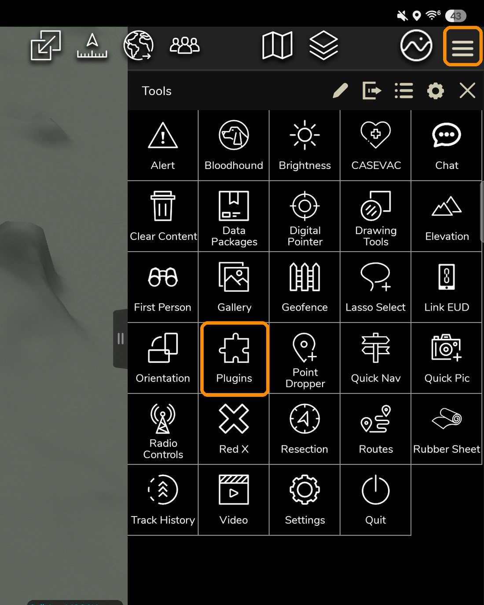
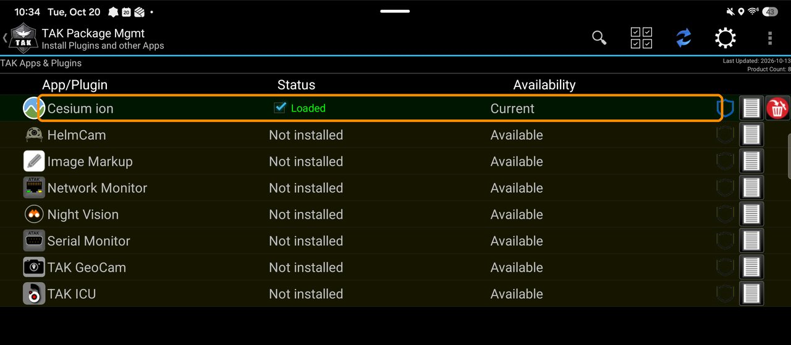
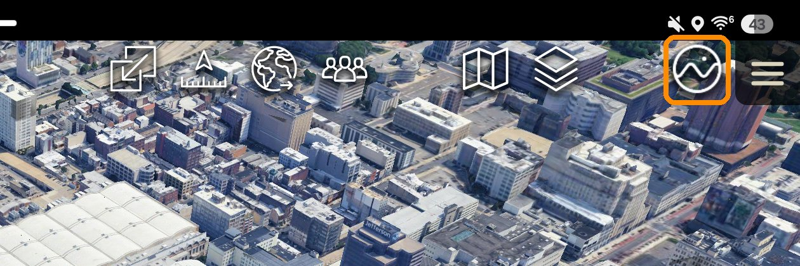
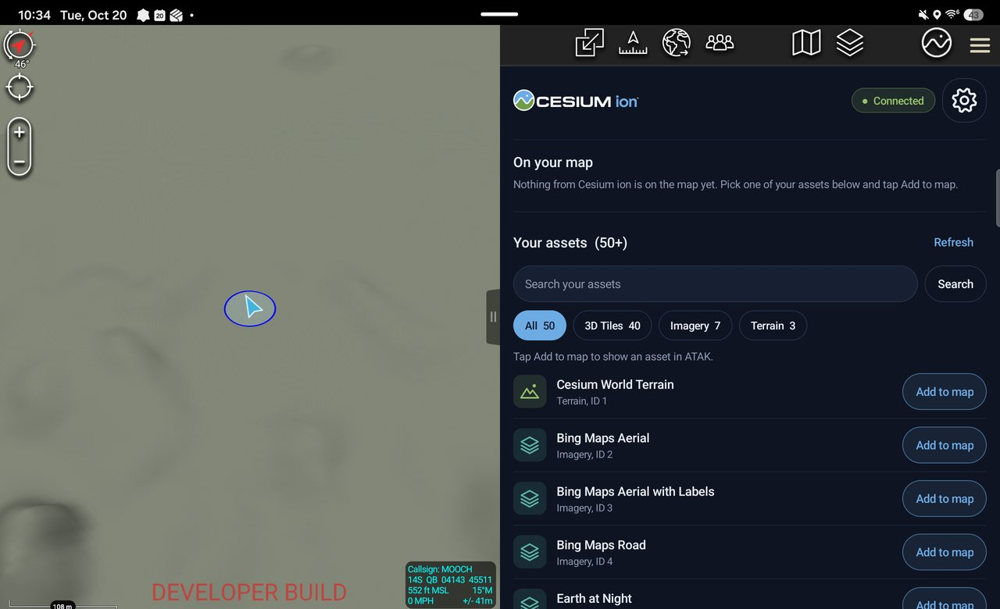
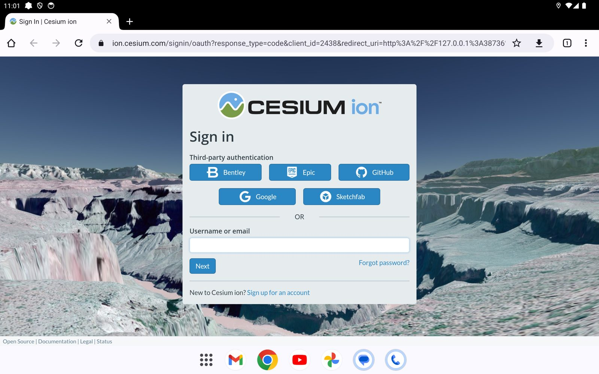
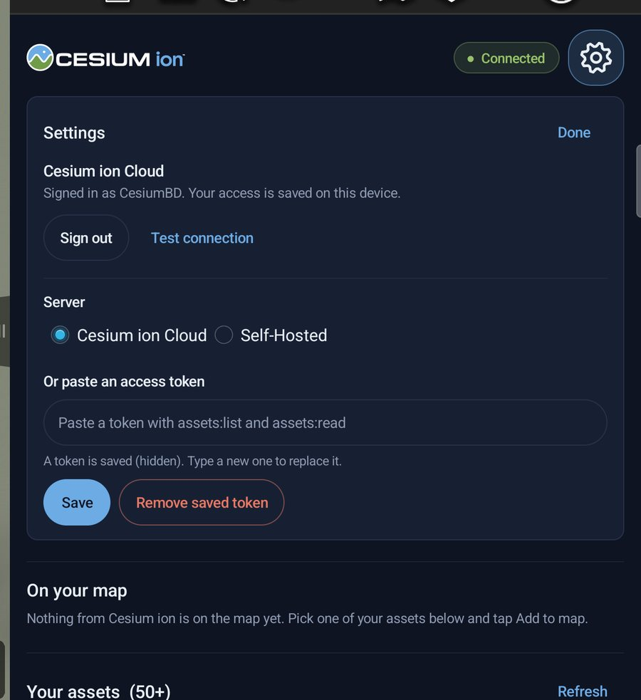
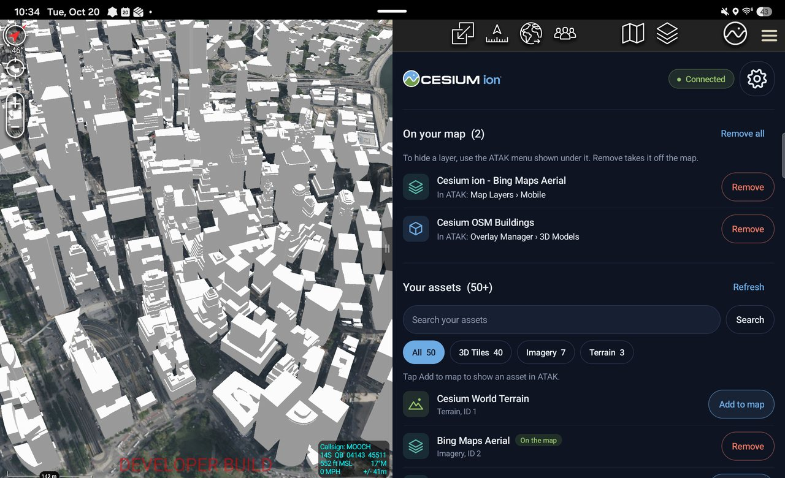

# Cesium ion for ATAK

The Cesium ion plugin for **ATAK-CIV 5.7** (Android): sign in with a Cesium
ion account, then add Google Photorealistic 3D Tiles, 3D buildings, imagery,
terrain, GeoJSON and KML to the ATAK map, from Cesium ion in the cloud or a
Cesium ion Self-Hosted server.

| | |
|---|---|
| **Status** | Version 1.0.2 released: signed by TAK.gov, loads in standard ATAK-CIV 5.7. A build for ATAK 5.6 (the Play Store's current version) is planned. |
| **Download** | [Releases](../../../releases), files named `ATAK-Plugin-CesiumIon-…apk` (tags `atak-v…`) |
| **Install** | [Step by step below](#install) |
| **Build from source** | [For developers](#for-developers) |


## Features

The plugin is built on the shared ion client in [`../core`](../core/README.md):

- Plugin lifecycle, with a toolbar button (the Cesium mark) that opens the
  Cesium ion pane, styled on Cesium's brand guide (see [Pane design](#pane-design))
- **Sign in with Cesium ion**: OAuth 2.0 with PKCE in the device's browser;
  no token to create or paste (see [Sign-in](#sign-in))
- **Tool Preferences > Cesium ion**: Cloud or Self-Hosted, server and API
  URL, single-user mode, cleartext opt-in, and an access token as the
  alternative to signing in
- Token encrypted with an Android Keystore key, never stored in or exported
  with ATAK's preferences, and never logged
- **Test connection**
- **Asset browser**: search your ion assets and load or remove them
  - **3D Tiles**: ion-hosted tilesets through the local tile proxy (the map
    flies to them), and Google Photorealistic 3D Tiles
  - **Imagery**: ion-hosted imagery (TMS), Bing Maps, and Google Maps 2D, as
    ATAK mobile map sources
  - **GeoJSON and KML/KMZ**: downloaded into ATAK's private storage and
    imported as overlays
  - **Terrain** (quantized-mesh, e.g. Cesium World Terrain): attached to
    ATAK's elevation through its built-in quantized-mesh support; tiles are
    downloaded on demand into ATAK's private storage (experimental)
  - CZML and glTF assets are listed but not loadable
- A loopback **tile proxy** that adds credentials to each request, so ATAK's
  files never hold an ion token

## Install

You need a **Cesium ion account** (cloud) or the address of a **Cesium ion
Self-Hosted** server.

### What you need

- An Android phone or tablet (Android 8 or later).
- **ATAK-CIV 5.7**. v1.0.2 is built for ATAK 5.7 and ATAK only loads plugins
  built for its own version. The Play Store currently has ATAK-CIV 5.6; get
  5.7 from [tak.gov](https://tak.gov) (free account; Products › ATAK-CIV), the
  release APK, not the SDK. A build for ATAK 5.6 is planned.
- The plugin from the [Releases](../../../releases) page:
  `ATAK-Plugin-CesiumIon-1.0.2-5.7.0-civ-signed.apk` (signed by the TAK
  Product Center, so standard ATAK loads it).

Test builds (`atak-v…-beta…`, prereleases) are signed with the SDK's
development key instead: they load only in the developer ATAK inside the
ATAK-CIV SDK (`atak.apk`), which replaces any other ATAK and its local data.

### 1. Install ATAK-CIV 5.7

If an older ATAK is installed, uninstall it first. Then copy the ATAK-CIV 5.7
APK to the device and open it, allowing installs from that app when Android
asks. Or, from a computer with USB debugging on:

```bash
adb install ATAK-<version>-civ-release.apk
```

Open ATAK once and finish its first-start setup (callsign, permissions).

### 2. Install the Cesium ion plugin

Copy the plugin `.apk` to the device and open it the same way, or:

```bash
adb install -r ATAK-Plugin-CesiumIon-1.0.2-5.7.0-civ-signed.apk
```

### 3. Load it in ATAK

Restart ATAK. When it asks to load new plugins, choose **Load**. If it does
not ask, open the menu (☰, top right) and tap **Plugins**:



In **TAK Package Mgmt**, **Cesium ion** should read **Loaded**. If it does
not, tap it and load it.



### 4. Open the Cesium ion pane

Tap the Cesium ion button on ATAK's toolbar (the Cesium mark). If it is not
there, add it to the toolbar from the menu (☰).



The pane opens on the right: the connection status and the settings gear at
the top, what is on your map, and your Cesium ion assets.



### 5. Sign in

- **Cesium ion Cloud:** tap **Sign in with Cesium ion**. ion's sign-in page
  opens in the browser; sign in there and you come back to ATAK with your
  assets listed. To use a team's assets, choose **Log in as a team** on ion's
  page and pick the team.
- **Self-Hosted:** tap the gear, choose **Self-Hosted**, enter the server URL
  (and the API URL if your administrator gave you one), and tap **Save**. A
  single-user server needs no sign-in.



The status at the top says **Connected**; hold it (or hover with a stylus or
mouse) to see who is signed in or which server you are on. The gear opens
**Settings**: the account (sign out, test the connection) and the server
(Cesium ion Cloud or Self-Hosted).



### 6. Add content to the map

Tap **Add to map** on any asset (3D Tiles, imagery, terrain, GeoJSON, KML).
Use the search box and type filters to find one. **On your map** then says
where ATAK shows each layer, which is also where to hide it:

| Content | Where it is in ATAK |
|---|---|
| 3D Tiles (incl. Google Photorealistic 3D Tiles) | Overlay Manager › 3D Models |
| Imagery | Map Layers › Mobile |
| Terrain | ATAK's elevation (remove it in the pane to turn it off) |
| GeoJSON, KML | Overlay Manager › File Overlays |

Tilt the map (two fingers up or down) to see 3D content and terrain.
**Remove** takes a layer off the map; **Remove all** takes everything off.




### If something goes wrong

- *ATAK does not list the plugin:* make sure ATAK is version 5.7 (menu ›
  Settings › About) and the plugin is installed; then restart ATAK. A test
  build (prerelease) needs the developer ATAK from the SDK.
- *Sign-in does not come back to ATAK:* finish signing in in the browser that
  opened, then switch back to ATAK; if the pane still says **Not signed in**,
  tap **Sign in with Cesium ion** again.
- *A layer shows nothing:* fly to where it is (3D Tiles fly there when added)
  and tilt the map; some test assets cover only a small area.

## For developers

Design and plan: [`../docs/architecture-and-plan.md`](../docs/architecture-and-plan.md).
Releasing and TAK.gov signing: [`docs/releasing.md`](docs/releasing.md);
static-analysis findings: [`SECURITY-NOTES.md`](SECURITY-NOTES.md).

### One-time setup on the Mac

1. **ATAK SDK:** use the extracted `ATAK-CIV-5.7.0-SDK` folder. It contains
   `atak-gradle-takdev.jar`, `main.jar`, `android_keystore`, and `atak.apk`.
2. **`local.properties`:** create it from the template. It is git-ignored; never commit it.
   ```bash
   cd atak
   cp template.local.properties local.properties
   ```
   Set `sdk.dir` to your Android SDK, e.g. `/Users/<you>/Library/Android/sdk`.
   You don't need to set an ATAK SDK path. The build looks for the folder
   holding `atak-gradle-takdev.jar`, `main.jar` and `android_keystore`, in this
   order:
   - the checkout's parent folders, including where the old plugin's
     `../../` default pointed
   - `~/Documents`, `~/Downloads`, `~/Desktop`, then `~`

   It prints what it found, plus a `takdev.plugin=` line you can add to pin
   that location. To pin it yourself, set `takdev.plugin` (the jar or the SDK
   folder; `~` works) or the `ATAK_SDK` environment variable.
3. **Android Studio:** **File > Open** the `atak/` folder, not the repository
   root.
   - Under Settings > Build, Execution, Deployment > Build Tools > Gradle, set
     **Gradle JDK** to the embedded JetBrains Runtime. AGP 9.3.1 with Gradle
     9.5.0 runs on it, including JDK 25.
   - Pick build variant **civDebug**.
   - In the run configuration, set **Launch** to **Nothing**. A plugin has no
     launcher activity.
4. **ATAK on the device:** the test device must run the SDK's `atak.apk`. A
   Play Store or release-signed ATAK rejects SDK-signed debug plugins.
   Replacing ATAK erases its local data, so use a dedicated test device or
   emulator.
   ```bash
   adb devices -l                     # note the serial of the target device
   adb -s <serial> uninstall com.atakmap.app.civ
   adb -s <serial> install ~/Documents/ATAK-CIV-5.7.0-SDK/atak.apk
   ```

#### Apple silicon emulator

Create an Android 14 ARM64 Pixel Tablet AVD and start it with ATAK's generic
EGL fallback. Without it, ATAK exits with `GLSurfaceView: No config chosen`.

```bash
$ANDROID_HOME/emulator/emulator -avd <your_avd> -gpu host \
  -prop dalvik.vm.extra-opts=-DUSE_GENERIC_EGL_CONFIG=true
```

The emulator's GPU path differs from real hardware. Treat **physical-device**
results as authoritative for rendering (S1).

### Build, test, install

```bash
cd atak
export JAVA_HOME="/Applications/Android Studio.app/Contents/jbr/Contents/Home"
./gradlew testCivDebugUnitTest      # plugin unit tests (no device)
./gradlew assembleCivDebug          # APK in app/build/outputs/apk/civ/debug/
./gradlew installCivDebug           # or: adb -s <serial> install -r <apk>
```

This build includes the shared core. To run the core's own tests, use
`cd ../core && ./gradlew test`.

Then in ATAK:

1. Open **Plugin Manager** and load **Cesium ion**. This build uses the same
   package name as the old WebView plugin and replaces it.
2. Add the **Cesium ion** toolbar button and open the pane. Tap **Sign in
   with Cesium ion**, sign in on ion's page in the browser, and you come
   back to ATAK with your assets listed. For Self-Hosted, first choose the
   server in **Settings**.
3. Tap **Add to map** on an asset. **On your map** then says where ATAK
   shows it, which is also where to hide it: Overlay Manager › 3D Models
   (3D Tiles), Map Layers › Mobile (imagery), Overlay Manager › File
   Overlays (GeoJSON, KML), or ATAK's elevation (terrain; remove it in the
   pane to turn it off).

Instead of signing in, you can paste an access token in **Settings**: it
needs only `assets:list` and `assets:read`; use a dedicated token, not your
full-access one.

### Device test loop (one command per iteration)

With the tablet on USB and USB debugging allowed, run this from the repository root:

```bash
atak/scripts/device-test.sh          # or: atak/scripts/device-test.sh 300
```

It runs these steps:

1. Checks the device and the installed ATAK.
2. Runs the unit tests and builds the APK.
3. Installs it.
4. Restarts ATAK and captures logcat while you test on the tablet, for as
   long as you need. The steps are printed for you; press **Enter** in the
   terminal (or Ctrl-C) when you're done. `device-test.sh 600` also ends the
   capture by itself after 600 seconds, in case you walk away.
5. Writes `atak/device-reports/<time>-report.txt` with credentials redacted.
   The folder is git-ignored.

Paste the report and what you saw on the map; that's one loop iteration.
Use `ANDROID_SERIAL=<serial>` if several devices are attached.

### Automated device tests

Debug builds accept test commands over adb (from the adb shell only: the
receiver requires the `DUMP` permission, which apps cannot hold, and it is
never registered in release builds). `device-test.sh --scenario` uses them to
run a scripted test with no tapping:

```bash
atak/scripts/device-test.sh --scenario smoke            # every asset type, ~3 minutes
atak/scripts/device-test.sh --scenario terrain          # Cesium World Terrain over Mount Rainier
atak/scripts/device-test.sh --scenario overlay-google   # GeoJSON parcels with Google 3D Tiles
```

The tablet must be on, unlocked, and set to stay awake (Developer options >
**Stay awake** while charging). ATAK only reloads plugins at startup when
its last shutdown was clean, and the old script force-stopped it. So the
script now asks the running plugin to close ATAK cleanly before installing,
taps ATAK's "load plugins" dialog if one appears, and as a last resort asks
you to load the plugin in Plugin Manager (waiting up to 5 more minutes). The
first run after this change may still need that manual load. Scenarios live in `atak/scripts/scenarios/`;
each line is one step:

| Step | Does |
|---|---|
| `load <assetId> [name]` | Loads an asset, as the pane's Load button does |
| `remove <assetId>`, `removeAll` | Removes one asset, or every Cesium ion layer |
| `fly <lat> <lon> <range-metres> [tilt]` | Moves the map |
| `basemap <percent>` | Sets ATAK's basemap opacity |
| `select <layer name>` | Shows an imagery layer from Map Layers > Mobile (loading imagery already does) |
| `wait <seconds>`, `screenshot <name>` | Waits; saves a screenshot next to the report |

#### Running them on the CI runners

`.github/workflows/device-test.yml` runs a scenario on a self-hosted GitHub
Actions runner (a Mac with a tablet attached) and publishes the redacted
report and screenshots to the `device-reports` branch. A push to the
development branch whose commit message contains `[device-test: <scenario>]`
starts it, so a change can be pushed, tested on the device and reviewed
without anyone at the Mac. Manual runs: Actions > **Device test (ATAK
tablet)** > Run workflow.

One-time setup, on the Mac with the tablet attached:

```bash
atak/scripts/setup-runner.sh
```

It downloads the GitHub Actions runner into `~/actions-runner-atak`,
registers it for this repository with the label `atak-device`, and starts it
as a background service. With the GitHub CLI logged in (`gh auth login`) it
fetches the registration token itself; otherwise it asks you to paste the
token from Settings > Actions > Runners > New self-hosted runner. Then keep
the tablet attached, unlocked, and set to stay awake.

What this allows: anyone who can push to the development branch or dispatch
workflows in this repository can build and run code on your Mac while the
runner is up. Pull requests never trigger it. GitHub advises against
self-hosted runners on public repositories; for a public repository, run
them from a private fork or mirror. Stop it with
`cd ~/actions-runner-atak && ./svc.sh stop`; remove it with
`atak/scripts/setup-runner.sh --remove`. The ion token never leaves the
tablet; reports are redacted as usual, and the raw logcat is not published.

### Loading assets

Open the pane from the toolbar. **My assets** lists the assets in your ion
account (50 at a time; **Load more** pages on). Search matches names and
descriptions. Each row has **Load** or **Remove**; **Loaded in ATAK** lists
everything loaded, from any search.

| Asset | How it reaches ATAK | What to check |
|---|---|---|
| ion 3D Tiles (e.g. Cesium OSM Buildings, 96188, or your own) | Streaming Mesh Configuration pointing at the tile proxy | The map flies to the tileset and tilts; Overlay Manager > 3D Models lists it |
| Google Photorealistic 3D Tiles (2275207, also a button) | Streaming Mesh Configuration, through the proxy | ATAK's basemap is hidden automatically; zoom to street level over a city |
| ion imagery (e.g. Sentinel-2, 3954, or your own GeoTIFF) | Mobile map source pointing at the tile proxy | Map Layers > Mobile > "Cesium ion - <name>" |
| Bing Maps (2, 3, 4) | Mobile map source with Bing's own tile URLs | Same |
| Google Maps 2D | Mobile map source pointing at the tile proxy | Same |
| GeoJSON, KML, KMZ | Downloaded to ATAK's private storage, imported as an overlay; GeoJSON is converted to KML 2 m above the ground so 3D Tiles do not hide it | Overlay Manager lists it; the map flies to GeoJSON |
| Terrain (Cesium World Terrain, 1) | ATAK quantized-mesh source (`QMESourceManager`), tiles cached on demand | Tilt over hills: the ground should take shape; ATAK's elevation readout should change |
| CZML, glTF | Not yet | The row says "Not yet" |

Loaded imagery is switched on automatically: the plugin selects it in
**Map Layers > Mobile**, which replaces ATAK's basemap with it. Removing it
puts Map Layers back on automatic selection. (ATAK's SELECT_LAYER broadcast
shows the Mobile layer but resets its selection, so the plugin also sets
the selection on the layer itself.)

**Remove all Cesium ion layers** removes everything the plugin loaded, plus
anything earlier builds or the old WebView plugin left behind (map sources
named `cesium-ion-*.xml` in `/sdcard/atak/imagery/mobile/mapsources`, and
untracked 3D Tiles configurations). Use it for a clean slate.

#### The tile proxy

The plugin runs an HTTP server on `127.0.0.1:38735` (another free port if that
is taken) while it is loaded. ATAK gets URLs like
`http://127.0.0.1:38735/<secret>/a/<assetId>/...`; the proxy forwards each
request to the asset's own host with the current endpoint token, refreshing it
when ion rejects it. So ATAK's layer files and caches hold no ion token.

- It listens on loopback only and serves only assets you loaded.
- The `<secret>` is random per install and stays in ATAK's private storage:
  3D Tiles configurations and imagery map sources are written there and
  imported from there, as ATAK does with its own bundled map sources.
- It never answers ATAK with 401/403 (ATAK would show a login dialog for the
  map source): an asset that is not loaded gets 404, and ion or upstream
  rejections that survive a token refresh get 502.
- ATAK keeps loaded layers across restarts; they stream again once the plugin
  has started. If ATAK draws them before the plugin starts, remove and load
  them again.

Google Photorealistic 3D Tiles go through the proxy as well (S1 proved the
direct path; the proxy keeps ion's Google key out of ATAK's model database).
Removing a tileset also deletes the "3D Model" layer ATAK builds from it;
ATAK otherwise reloads that layer at every start. A Google layer loaded by
an earlier build (an `https://tile.googleapis.com` model) cannot be deleted
by the plugin: remove it in Overlay Manager > 3D Models.

### Photorealistic 3D Tiles and ATAK's basemap

ATAK drapes its basemap (Bing, Google 2D, and so on) on its own terrain, which
is DTED, or flat where there is none. Under photorealistic 3D Tiles that gives
two ground surfaces: wherever ATAK's is a few metres higher, the basemap cuts
through the photogrammetry.

The pane's **ATAK basemap opacity** slider and its **Hide basemap** and
**Show basemap** buttons drive ATAK's `TerrainBlendControl` (from
`MapRenderer3.getControl`) to fade that surface. This is the ATAK equivalent
of CesiumJS hiding its globe under Google Photorealistic 3D Tiles.
Fading the fill leaves ATAK drawing the terrain mesh's lines, so while faded
the plugin also switches off `SurfaceRendererControl`'s line draw modes and
restores them afterwards. Removing Google Photorealistic 3D Tiles restores
the basemap.

**Camera moves** (framing a new tileset or overlay, and the test `fly`
command) use `MapRenderer3.lookAt` with the ground height under the target,
looked up off the main thread. `AtakMapController.panZoomTo` looks the height
up on the main thread itself, which froze ATAK for up to a minute (an ANR)
while quantized-mesh terrain was loading.

**Turn on rotate and tilt** (Map display) turns on ATAK's two-finger gestures through
`MapTouchController` (`setUserOrientation`, `setTiltEnabledState`): twist two
fingers to rotate, drag two fingers up or down to tilt.

### Settings: pane and Tool Preferences

The **Settings** button in the pane holds every connection setting: Cloud or
Self-Hosted, server and API URL, single-user mode, cleartext opt-in, and the
token. They open by themselves only when a build has no OAuth client ID (so
pasting a token is the only way in).

The same settings are under ATAK **Settings > Tool Preferences > Cesium ion**.
In ATAK 5.7 the registry is `com.atakmap.app.preferences.ToolsPreferenceFragment`,
not `com.atakmap.android.preference` as in older plugin templates. Both screens
write the same values.

`atak/scripts/device-test.sh` lists the SDK's preference classes and their
signatures in every report, so the registration can be pointed at the real
API.

**Self-Hosted imagery covering a small area** (for example the test server's
USGS Philadelphia aerial, about 2 x 3 km): ATAK asks for every tile in view,
and the server answers 404 for those outside the asset's coverage, so the
proxy's summary can read "N requests, N failed" while the imagery shows
where it exists. `server-probe.sh` prints the asset's `tilemapresource.xml`
(bounding box, zoom levels) and fetches one tile per level, which tells
missing coverage from a server problem.

### Sign-in

**Sign in with Cesium ion** is the OAuth 2.0 authorization code flow with
PKCE (RFC 7636) for a public client, as Cesium for Unreal uses (core:
`auth/IonOAuth`, `auth/LoopbackReceiver`; plugin: `IonSignIn`):

1. The plugin opens `<server>/oauth` (ion.cesium.com for Cloud) in the
   browser with client ID 2438, scopes `assets:list assets:read profile:read`
   (read-only; `profile:read` gives the username shown as who is signed in), a random
   `state` and an S256 code challenge.
2. The person signs in on ion's own page; the plugin never sees the password.
3. ion redirects to `http://127.0.0.1:38736/cesium-tak/oauth2/callback`,
   where the plugin listens for up to 5 minutes, checks `state`, and
   exchanges the code at `<api>/oauth/token` for an access token.
4. The token is stored like a pasted one (`SecureTokenStore`), and the app
   comes back to the front.

The client ID belongs to an ion OAuth application on the CesiumBD team; it
is public (there is no client secret). Builds can use another with
`-PionOAuthClientId=<id>`, or none (`''`), which leaves token pasting only.
**Sign out** removes the saved access from the device.

### Pane design

The pane follows Cesium's brand guide from the press kit at
[cesium.com/press](https://cesium.com/press): the Cesium ion wordmark (light
version, for dark backgrounds) heads the pane, the toolbar uses Cesium's
single-colour mark (ATAK tints toolbar icons), both unaltered, and the
colours are Cesium black `#0E1422` (ground), Cesium blue `#6DABE4` (actions,
3D Tiles) and Cesium green `#709C49` (on the map, terrain).

Top to bottom: account (sign in, settings, connection problems), **On your
map** (each layer with its place in ATAK's menus), **From Cesium** (global
layers not already in the account), **Your assets** (search, type filters,
Add to map), **Map display** (basemap fade, rotate and tilt) and
**Activity** (the redacted log).

### Layout

| File | Role |
|---|---|
| `CesiumIonPlugin` | `IPlugin` lifecycle; toolbar and Tool Preferences registration |
| `PaneSettingsForm` | In-pane settings (always available) |
| `BasemapBlend` | Fades ATAK's basemap surface (`TerrainBlendControl`) and hides terrain mesh lines (`SurfaceRendererControl`) |
| `MapGestures` | Enables two-finger rotate and tilt (`MapTouchController`) |
| `IonPreferenceFragment` + `res/xml/ion_preferences.xml` | Tool Preferences; intercepts the token into `SecureTokenStore` |
| `SecureTokenStore` | AES-256-GCM with an Android Keystore key; separate Cloud and Self-Hosted slots |
| `IonSettings` | Preferences to `IonServer`/`IonClient` (no Android types; unit-tested) |
| `IonPane`, `PaneStyle` | Pane UI: account, on your map, asset browser, map controls, redacted activity log; brand palette, type icons |
| `IonSignIn` | "Sign in with Cesium ion": browser, loopback redirect, token exchange |
| `IonSession` | Current `IonClient` and endpoint cache; reset when settings or the token change |
| `ProxyHost` | Runs the core `TileProxy` with a stable per-install secret and port |
| `AssetLoader`, `LoadedAssets`, `LayerNames` | Loads and removes assets by type; remembers what is loaded |
| `IonTerrainLayer` | ion quantized-mesh terrain as an ATAK `QMESourceLayer` |
| `TestCommands` | Debug builds: adb-driven test commands for `device-test.sh --scenario` |
| `AtakImports`, `StreamingMeshConfig`, `MapSourceXml` | ATAK import and removal of 3D Tiles, map sources, and overlays |
| `PluginLog` | Logcat tag `CesiumIon`, always redacted |
