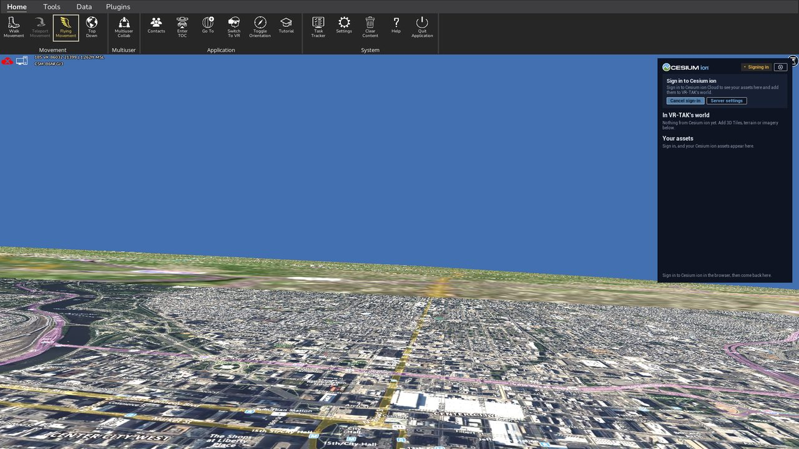
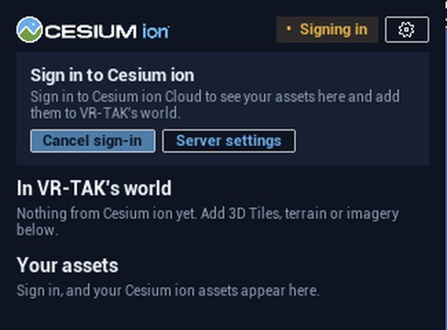
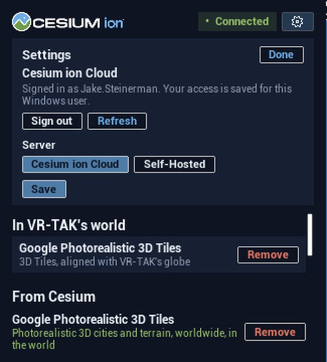
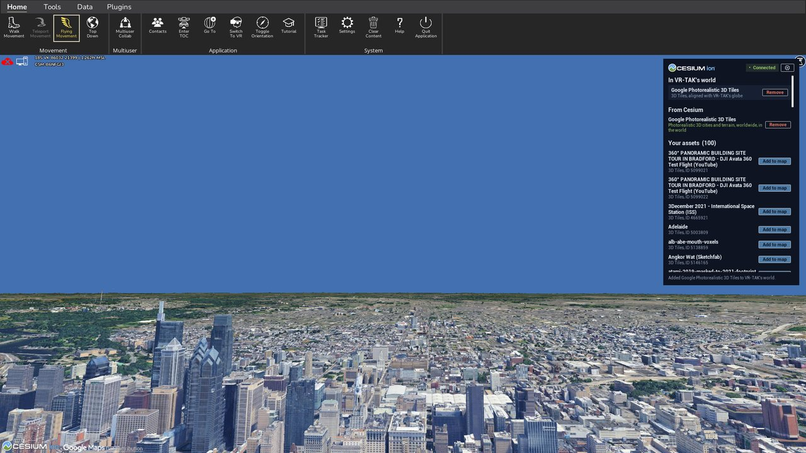
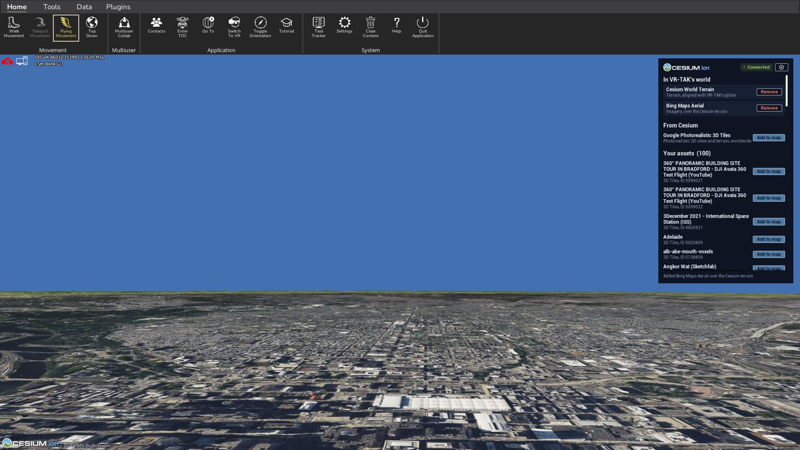

# Cesium ion for VR-TAK

The Cesium ion plugin for **VR-TAK** (Unreal Engine 5.3, desktop and
headset): a Cesium ion panel inside VR-TAK to sign in, then add Google
Photorealistic 3D Tiles, Cesium World Terrain, Bing Maps imagery and your own
3D Tiles, terrain and imagery to VR-TAK's world, from Cesium ion in the cloud
or a Cesium ion Self-Hosted server. Content sits in place on VR-TAK's globe.

| | |
|---|---|
| **Status** | Early version, not released yet. Content works (Cloud and Self-Hosted); a toolbar button and a headset panel come next. Releases go through the VR-TAK team; the route is being confirmed. |
| **Download** | Not yet. Releases will be tagged `vrtak-v…` on the [Releases](../../../releases) page. |
| **Install** | [Step by step below](#install) |
| **Build from source** | [For developers](#for-developers) |

> VR-TAK is marked Distribution Statement F. Screenshots of VR-TAK in this
> folder are shared with the owner's approval.

## Features

- **Sign in with Cesium ion** (OAuth 2.0 with PKCE in the browser; "Log in
  as a team" supported), or connect to a single-user Self-Hosted server. The
  access is saved for the Windows user.
- **From Cesium**: Google Photorealistic 3D Tiles, Cesium World Terrain and
  Bing Maps Aerial, one click each.
- **Your assets**: 3D Tiles, terrain and imagery from your account or
  server. Imagery drapes over Cesium terrain.
- While Cesium terrain is in the world, VR-TAK's own map steps aside (the
  same switch as VR-TAK's Terrain setting) and comes back when it is removed.
- Content follows whichever VR-TAK globe is in use (tabletop or world).
- GeoJSON and KML are not supported in VR-TAK yet.

## Install

### What you need

- VR-TAK 5.0 on Windows (desktop or headset).
- The release's `VTAK_CesiumIon` plugin folder (built for that VR-TAK version).
- Cesium for Unreal 2.17 (the UE 5.3 build) in the same `Game\Plugins` folder;
  the release will include it.
- A Cesium ion account, or the address of a Cesium ion Self-Hosted server.

### 1. Install the plugin

Close VR-TAK. Copy the `VTAK_CesiumIon` folder
into VR-TAK's `Game\Plugins` folder (for example
`C:\Program Files\Epic Games\VR-TAK\Game\Plugins\VTAK_CesiumIon`).

### 2. Start VR-TAK and enter the world

The Cesium ion panel appears at the
top right, below VR-TAK's ribbon.

### 3. Sign in

Click **Sign in with Cesium ion**. ion's sign-in page opens
in your browser; sign in there (choose **Log in as a team** to use a team's
assets), then return to VR-TAK. The access is saved for your Windows user.
For Self-Hosted, open the gear and choose **Self-Hosted** first.

### 4. Check the account

The gear opens **Settings**: who is signed in, Sign
out, and the server (Cesium ion Cloud or Self-Hosted).

### 5. Add content

Under **From Cesium** or **Your assets**, click **Add to
map**. Google Photorealistic 3D Tiles over Philadelphia:

Cesium World Terrain with Bing Maps Aerial on it (add the terrain first, then
the imagery). While Cesium terrain is loaded, VR-TAK's own map is turned off;
it comes back when you remove the terrain.

## For developers

- **Source:** [`plugin/VTAK_CesiumIon`](plugin/VTAK_CesiumIon). It goes in
  VR-TAK's `Game\Plugins` folder and depends on VR-TAK's `VH_Globe` plugin
  and on **Cesium for Unreal 2.17** (the last release for UE 5.3), which goes
  in `Game\Plugins` too.
- **Build:** VR-TAK's engine layer must be built once, as the VR-TAK Plugin
  Developer Guide describes; then the GameEditor target compiles the plugin.
  [`scripts/vrtak-engine-build.ps1`](scripts/vrtak-engine-build.ps1) does
  both on a Windows PC with Visual Studio 2022 (MSVC 14.36), and
  [`scripts/cesium-unreal-build.ps1`](scripts/cesium-unreal-build.ps1)
  downloads Cesium for Unreal's source release first.
- **Install and run:** [`scripts/vrtak-plugin-install.ps1`](scripts/vrtak-plugin-install.ps1)
  copies the plugin into VR-TAK; [`scripts/vrtak-launch.ps1`](scripts/vrtak-launch.ps1)
  starts VR-TAK with the plugin's test switches (server, origin, assets to
  add, screenshots) and checks its log.
- **Automated runs:** `.github/workflows/vrtak.yml` runs a task from
  `scripts/` on a self-hosted Windows runner when a push's commit message
  contains `[vrtak: <task>]`, and publishes the report to the
  `device-reports` branch. Runner setup:
  [`../.github/scripts/setup-runner-windows.ps1`](../.github/scripts/setup-runner-windows.ps1).
- **Engineering notes** (how VR-TAK plugins work, the build, design
  decisions): [`docs/engineering-notes.md`](docs/engineering-notes.md).
- [`host/`](host) is a small Unreal project used to build Cesium for Unreal
  outside VR-TAK.
